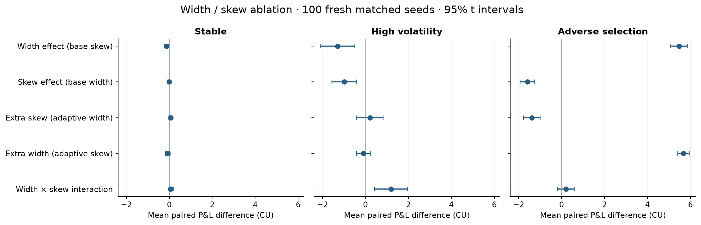
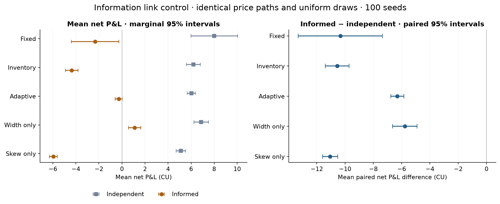

# Mechanism study — width, skew and informative fills

Follow-up recorded 25 October 2026 · all amounts fictional CU · no real trading results.

## What this adds

The original Adaptive policy changed two controls at once. This follow-up uses
a 2×2 inventory-policy design to separate them, then holds stress prices exactly
fixed while replacing informative customer directions with independent ones.
It also re-evaluates the original policies on a fresh seed set. This is an
exploratory follow-up motivated by the original results, not a claim that those
mechanisms were isolated in the original study.

The [addendum plan](RESEARCH_ADDENDUM_PLAN.md) was saved before these experiments.
No coefficients were tuned. Each case uses 100 new matched seeds (30000–30099),
disjoint from all original seed sets. Three scenarios × five policies = 1,500
ablation runs; an additional 500 independent-flow runs give **2,000
new strategy runs**. The 500 informed stress rows are reused in the flow-control
CSV, not counted a second time. Along with the original 3,480 strategy runs,
there are **5,480 research runs**. This count is not the number of independent
market paths. The extension took 11.3 seconds on this Mac.

## Policies and fixed conditions

Inventory uses centre S−κq and width h. Width only changes width to hr; Skew only
changes centre to S−κqr². Adaptive changes both. Both added controls still manage
inventory: "only" refers to the volatility-dependent adjustment. Fixed provides
context. Defaults remain h=0.05 CU, κ=0.015 CU/unit, 30-return RMS and a fixed
0.04 CU/√second warm-up prior. Every policy receives current/past prices only.
Same fees, caps, quote clipping, 600-second horizon and terminal mark-to-market
convention as the [original model](MODEL.md). No terminal closing trade is added.

## Factorial outcomes

| Scenario | Policy | Mean net P&L | Mean max DD | Mean abs inventory | Mean fills |
|---|---|---|---|---|---|
| Stable | Fixed | 6.421 | 4.502 | 4.476 | 151.630 |
| Stable | Inventory | 6.282 | 0.844 | 1.158 | 163.570 |
| Stable | Adaptive | 6.211 | 0.913 | 1.183 | 165.730 |
| Stable | Width only | 6.151 | 0.861 | 1.155 | 165.530 |
| Stable | Skew only | 6.275 | 0.861 | 1.169 | 163.610 |
| High volatility | Fixed | 5.269 | 14.603 | 4.476 | 151.630 |
| High volatility | Inventory | 6.248 | 3.100 | 1.158 | 163.570 |
| High volatility | Adaptive | 5.171 | 1.171 | 0.697 | 110.370 |
| High volatility | Width only | 4.960 | 3.399 | 1.145 | 100.190 |
| High volatility | Skew only | 5.263 | 1.672 | 0.866 | 159.630 |
| Adverse selection | Fixed | -2.323 | 12.970 | 4.476 | 151.630 |
| Adverse selection | Inventory | -4.363 | 5.853 | 1.158 | 163.570 |
| Adverse selection | Adaptive | -0.281 | 2.017 | 0.533 | 91.960 |
| Adverse selection | Width only | 1.101 | 3.098 | 1.122 | 78.970 |
| Adverse selection | Skew only | -5.953 | 6.376 | 0.691 | 164.580 |

[All 1,500 rows](RESULTS/mechanisms/ablation_runs.csv) ·
[Means, SD, percentiles and intervals](RESULTS/mechanisms/ablation_summary.csv) ·
[All paired contrasts](RESULTS/mechanisms/ablation_pairs.csv)

Intervals are two-sided 95% Student t intervals on seed-level differences;
shared horizontal scales permit comparison. They are unadjusted for multiple
comparisons. The interaction is Adaptive−Width only−Skew only+Inventory. It
measures departure from adding the two isolated effects, not a regression fitted
to real market data. Secondary risk/fill contrasts are saved alongside P&L.

In adverse selection, Width only−Inventory is
**+5.464 CU [+5.080, +5.847]**. Strengthening skew
alone gives **-1.590 CU [-1.929, -1.252]**. Adaptive−Width
only is **-1.382 CU [-1.770, -0.994]**. Thus the combined
policy's improvement in this stress comes primarily from its width adjustment;
stronger skew is costly here. Width only's own mean is +1.101 CU
(marginal 95% interval [+0.560, +1.641]); Adaptive's is
-0.281 CU. This positive toy-market mean for Width only does not establish
an executable edge or robustness outside these fixed assumptions. The original
fee/volatility sensitivities covered three policies, not these new controls.

A plausible model mechanism is that stronger skew repeatedly offers a closer
inventory-reducing quote to informative customers, sacrificing execution edge.
The ablation establishes the policy effect within the simulator; it does not
identify every individual fill-level causal pathway.

In High volatility, Width only−Inventory is
**-1.288 CU [-2.085, -0.491]**, and the combined policy's
interaction is **+1.195 CU [+0.428, +1.962]**. The
controls do not simply add: inventory feedback, distance-dependent acceptance
and clipping make the response nonlinear. Lower inventory exposure, lower
drawdown, fewer fills and higher profit remain distinct objectives.

## Replication changes how strongly the original ranking should be stated

On these fresh Stable seeds, Inventory−Fixed is
**-0.139 CU [-0.967, +0.690]**. Compare the original −1.312 CU
[−2.279, −0.346]. The new interval crosses zero. Inventory exposure and drawdown
remain much lower, but the original stable-market mean-profit penalty is not a
reliable universal ranking across these two finite seed batches. Fixed has
substantial path dispersion; preserve both batches rather than choosing one.
Similarly, differences involving Fixed in High volatility are sensitive to
which paths were sampled. Do not pool or cherry-pick scenarios to manufacture
confidence. No claim of a uniformly best policy is supported.

## Same prices, independent customer directions

The control leaves every reference value, arrival uniform and acceptance uniform
unchanged for each seed. The original latent sign continues to generate the
stress prices. Only the direction of the arriving customer is replaced using a
separate deterministic random stream. Thus volatility, jumps (none in this
case), price distribution and the realized price path cannot explain a
stress/control difference. This is stronger than comparing the original Stable
and Adverse selection scenarios, which also changed volatility.

All 100 seed pairs passed exact array equality checks for prices and both
uniform tapes. Mean within-path direction/next-log-return correlation is
**0.8507** for informed flow and
**-0.0028** for independent flow. The
latter fluctuates around zero in finite samples. Strategy-specific fills can
differ because arriving directions and subsequent inventories differ.

| Policy | Informed minus independent | 95% low | 95% high |
|---|---|---|---|
| Fixed | -10.337 | -13.310 | -7.363 |
| Inventory | -10.562 | -11.403 | -9.721 |
| Adaptive | -6.305 | -6.772 | -5.837 |
| Width only | -5.775 | -6.639 | -4.911 |
| Skew only | -11.057 | -11.590 | -10.523 |

The right panel and table use paired mean intervals; the left panel uses marginal
mean intervals. Do not compare marginal-interval overlap as a significance test.
Every saved P&L interval here is below zero: the information link harms all five
policies on this seed batch, even though wider quotes reduce the damage. This is
a counterfactual result inside an explicitly imposed model, not measured causal
evidence about a real exchange.

[Raw control rows](RESULTS/mechanisms/flow_control_runs.csv) ·
[Control summaries](RESULTS/mechanisms/flow_control_summary.csv) ·
[All control contrasts](RESULTS/mechanisms/flow_control_pairs.csv) ·
[Direction diagnostics and price hashes](RESULTS/mechanisms/tape_diagnostics.csv)

## Verification, limitations and reproduction

The added tests check isolated policy formulas, historical-only observations,
exact preservation of the original market tapes, equal stress/control price
and uniform arrays, loss of directional information, deterministic control
replay, and rejection of incomplete/nonfinite paired samples. An independent
saved-row audit recomputes all factorial and flow intervals. Main-study CSV
metrics were checked against the original release and remained unchanged.
See [VALIDATION.md](VALIDATION.md) for test counts and browser evidence.

These checks strengthen internal validity. They do not validate the assumed
fill curve, calibrate real customer behavior, model queues/latency/impact,
account for financing or price a real terminal liquidation. The original
adverse shock is a non-Gaussian mixture; its −σ²/2 log drift correction remains
approximate. That approximation is identical in both matched flow conditions.
Only three selected regimes and one skew/width configuration are included in
the ablation. Further parameter stress tests, transaction-level decomposition
and out-of-model evaluation would be needed before generalizing its ranking.

Run `bash reproduce.sh` for both studies, charts, reports and audits. No data
network is needed after installing dependencies. In Research, load Mechanism
study, or enable width/skew controls for new runs. The Informative customer flow
checkbox creates the same-price counterfactual in Adverse selection only.
