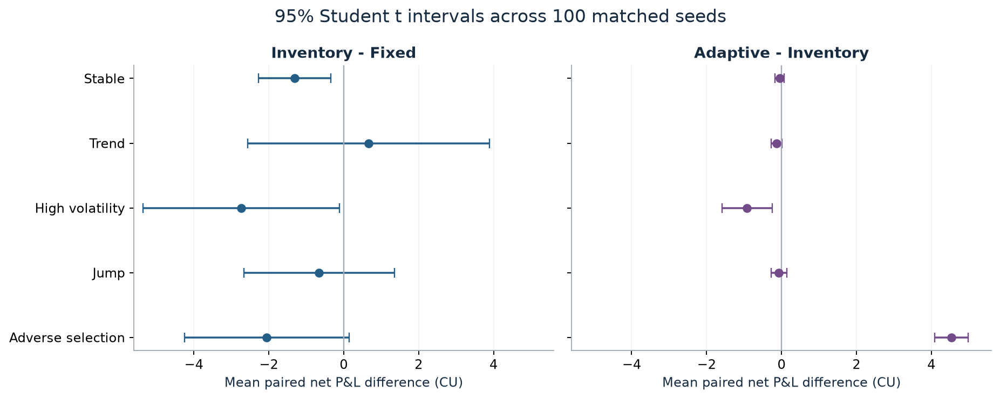

# Market Maker Arena

**An interactive market-making simulator and strategy research lab.**

A local educational Python project for discussing spread capture, inventory risk and execution opportunity in UK Spring Week interviews. Play against a causal quoting policy, then inspect reproducible paired experiments. The implementation was developed with substantial AI assistance; see [CV_DRAFT.md](CV_DRAFT.md) before using it in an application.

**Simulation only.** No exchange connection, live trades, real customers or claimed trading performance. Synthetic fills and reference-price marks are model assumptions. A positive modeled P&L does not establish a tradable edge.

## Run locally

Use Python 3.12 (the saved study used Python 3.12.14 on Apple Silicon macOS).
Clone the public repository, then run from its root:

```bash
git clone https://github.com/zyjroger1-hub/market-maker-arena.git
cd market-maker-arena
python3.12 -m venv .venv
.venv/bin/python -m pip install -r requirements.txt
.venv/bin/python -m streamlit run app.py --server.address 127.0.0.1
```

Open http://127.0.0.1:8501. On macOS, subsequent launches can use
`zsh launch.command`. Stop the server with Ctrl+C. On Windows use the equivalent
Python executable in `.venv/Scripts/` and run the commands from a terminal.

Installation needs internet once. Core simulation, saved results and the full
experiment workflow subsequently run offline. No account, trading API key or
paid data service is needed. `requirements-lock.txt` records the tested package
versions; `requirements.txt` installs that locked environment. The virtual
environment is excluded from the repository.

For an online interactive demo, see [DEPLOYMENT.md](DEPLOYMENT.md). Deployment
is separate from publishing the source repository. The local launch command
binds to loopback; the cloud configuration delegates binding to the platform.

## Try it in five minutes

1. **Play:** Stable, seed42, Adaptive opponent. Advance 50 steps with the default full spread 0.10 CU.
2. Inspect cash, inventory and equity. If long, lower the quote centre or pause bid to reduce further buying; compare the resulting executions. The reference follows the same hidden path for both dealers.
3. Replay with the same seed and another quoting rule. Change to Jump or Adverse selection. Finish all 600 steps to compare net P&L, drawdown, fills and inventory.
4. **Research:** initially shows the completed main experiment. Select a scenario; inspect P&L dispersion, inventory/outcome scatter, paired intervals and the example drawdown. Sidebar controls run new paired experiments. Changed-but-unapplied controls trigger a warning, and downloads retain the last applied configuration.
5. **Model & evidence:** read assumptions and learning documents. Core definitions are also in [MODEL.md](MODEL.md).

During a Play round, your chosen width/offset is recalculated relative to the current reference on every step. It is not an unchanging pair of absolute prices for the whole round. Pausing a side stops its new fills; existing inventory still carries price risk. Both dealers trade in separate counterfactual markets, without competing for one customer's unit.

## Reproduce and inspect

```bash
bash reproduce.sh
```

This runs tests, all planned experiments, figures, the report and an independent saved-results audit. It overwrites the generated outputs for the fixed design. Save your own exploratory variants separately. The original plan is retained. No network is used.

Individual steps:

```bash
.venv/bin/python -m pytest -q
.venv/bin/python scripts/run_experiments.py
.venv/bin/python scripts/make_figures.py
.venv/bin/python scripts/write_report.py
.venv/bin/python scripts/validate_results.py
```

The saved study contains **1,500 main runs** (5 scenarios × 100 paired seeds × 3 policies), **360 exploration runs**, and **1,620 sensitivity runs**, totaling **3,480 research runs**, plus 15 representative trace reruns. Main seeds start at 10000, exploration at 1000, sensitivity at 20000. See [RESEARCH_PLAN.md](RESEARCH_PLAN.md) and [RESULTS/config.json](RESULTS/config.json).

## What the results say

In Stable, inventory skew reduced mean absolute inventory by 75.0% and reduced drawdown, while mean net P&L fell by 1.312 CU relative to Fixed. In High volatility, Adaptive reduced drawdown and fills but also reduced mean P&L relative to Inventory. In Adverse selection, Adaptive improved mean P&L by 4.533 CU relative to Inventory while its own mean remained −0.305 CU. These are conditional simulation findings, not real trading returns.

The [research report](RESEARCH_REPORT.md) includes distributions, paired intervals, risk/opportunity plots, a preselected path, sensitivities and limitations. The [results index](RESULTS/README.md) maps every chart and number to raw data.



## Model in brief

A positive log reference-price process evolves once per second. A synthetic customer arrives with probability 1−exp(−AΔt), at most one per step. A quote at distance δ is accepted with probability exp(−kδ). Each fill is one unit with a notional fee; the hard inventory cap disables unsafe sides. Quotes precede customer arrivals and fills; reference prices then change and equity is marked. Policies receive only the current and past reference prefix.

- **Fixed:** constant symmetric half-spread.
- **Inventory:** shift centre against inventory.
- **Adaptive:** also scale width and skew using a 30-return trailing RMS estimate.

The ending is **mark-to-market with inventory retained**, not a free liquidation. Cash, inventory, fees and the P&L decomposition are reconciled. Policies borrow reservation-price intuition; they are not an exact Avellaneda–Stoikov solution or a globally optimal policy.

## Files and learning route

| File/folder | Purpose |
|---|---|
| `arena/engine.py` | Immutable market tape, event sequence, fills, caps, accounting |
| `arena/strategies.py` | Three causal policies and manual quoting rule |
| `arena/experiments.py` | Matched runs, summaries and paired intervals |
| `app.py` | Streamlit Play/Research interface and explanatory views |
| `scripts/` | Offline experiments, figures, report and independent audit; separate optional downloader |
| `tests/` | Engine and Streamlit state/interaction tests |
| [RESEARCH_REPORT.md](RESEARCH_REPORT.md) | Actual findings and chart links |
| [LEARNING_GUIDE_ZH.md](LEARNING_GUIDE_ZH.md) | Chinese explanations, worked accounting and code-reading order |
| [INTERVIEW_PREP.md](INTERVIEW_PREP.md) | Ten questions, honest explanations and personal exercises |
| [CV_DRAFT.md](CV_DRAFT.md) | Conditional trading/research and tech wording; AI contribution disclosure |
| [VALIDATION.md](VALIDATION.md) | Test, numerical and browser verification scope |
| [data/README.md](data/README.md) | Optional real-price context, provenance and usage conditions |

## Key limits

The acceptance curve is assumed, not a reconstructed queue. There is no order book, competing dealer, latency, impact, partial fill, financing or executable terminal liquidation. Adaptive changes two controls simultaneously and reacts with lag. Monte Carlo intervals do not cover model error. A small BTC minute sample provides descriptive volatility context only; it neither calibrates defaults nor establishes historical fills or profits.

Primary references, verified 25 October 2026: [Citadel Securities](https://www.citadelsecurities.com/what-we-do/what-is-a-market-maker/), [Avellaneda & Stoikov (2008)](https://math.nyu.edu/inmemoriam/avellaneda/HighFrequencyTrading.pdf), [HftBacktest fill documentation](https://hftbacktest.readthedocs.io/en/latest/order_fill.html), [Binance public data](https://github.com/binance/binance-public-data). Dataset-derived materials retain the source's usage terms and attribution; this project is not endorsed by these organizations.
